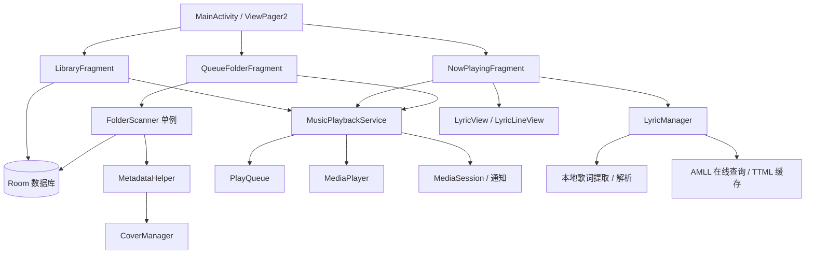

# EnsoMusic 架构与实现

本文描述 EnsoMusic 的系统架构与核心实现。EnsoMusic 是面向 Android 8.1（API 27）智能手表的离线优先本地音乐播放器，基于 Kotlin、Android View/XML、协程和 Room 构建。应用通过直接遍历用户授权的目录管理曲库，不依赖系统 `MediaStore` 音乐索引；联网功能仅用于获取在线歌词。

## 系统结构

**组件协作关系：**
- **UI 层（Fragment）** 直接观察 Room 数据库，并与播放服务和歌词管理器交互。
- **服务层（`MusicPlaybackService`）** 集中管理播放状态与音频生命周期。
- **数据与后台层** 由 Room 持久化曲库，`FolderScanner` 和 `LyricManager` 分别在独立的协程作用域中处理文件扫描与歌词加载。

## 播放与队列

### 服务及状态

`MusicPlaybackService` 是绑定式前台服务，作为播放状态的唯一真实来源（Single Source of Truth）。`MainActivity` 负责维护服务连接，UI 层通过服务暴露的 `StateFlow` 订阅 `PlaybackInfo`、播放队列、细粒度音量和睡眠定时器状态。`PlaybackInfo` 明确区分“准备中”、“播放中”与“错误”状态，确保异步加载期间的 UI 状态准确。服务同时统一管理 `MediaSession`、媒体通知、音频焦点及输出设备切换。

播放器通过 `prepareAsync()` 异步准备音频，并引入“准备代次（Generation）”机制，防止已取消的旧请求回调污染当前播放状态。播放失败时，服务向外发布错误状态并按队列规则自动跳转。正常播放时，服务在满足条件时预先初始化下一个 `MediaPlayer` 并通过 `setNextMediaPlayer` 实现无缝衔接（取决于具体音频编码格式）；当循环模式、队列或睡眠定时器状态改变时，自动释放已失效的预备播放器。

服务监听音频焦点、`ACTION_AUDIO_BECOMING_NOISY` 广播及蓝牙连接事件，在输出设备断开或焦点丢失时自动暂停或调节音量。此外，服务内置音频淡入淡出、睡眠定时停止以及 0–100 级的对数感知音量控制。

### 队列规则

`PlayQueue<T>` 是平台无关的纯 Kotlin 队列模型，负责维护歌曲列表、当前索引和随机序列。支持队列重置、定点跳转、前后切歌、下一首插入及条目移除，每次变更后由服务生成不可变快照发布给 UI。

- **播放模式**：支持列表循环、单曲循环、随机播放和顺序播放（UI 按钮循环切换前三种模式）。
- **边界行为**：曲目自然结束时，单曲循环重播当前曲目，顺序播放至队尾后停止；用户手动点击“下一首”时，在队尾自动回绕至队首。
- **随机算法**：单轮随机播放使用固定洗牌序列，保证前后切歌路径一致；一轮结束后重新洗牌，并规避新序列首尾与上一首重复。
- **动态维护**：增删队列条目时动态修正随机序列与当前索引。核心逻辑由 `PlayQueueTest` 进行 JVM 单元测试覆盖。

### 状态持久化与恢复

队列中的文件路径持久化至应用私有目录的 `playback_queue.txt`；当前曲目、播放进度、索引及配置项保存于 `SharedPreferences`。

服务启动时异步读取路径列表并结合数据库恢复队列对象；若恢复完成前用户已主动发起新的播放请求，则优先保留用户操作，放弃旧状态回写。恢复期间收到的媒体控制指令会暂存并延后执行。运行期间服务定期记录播放进度，并在冷启动恢复且播放器准备就绪后自动执行 `seekTo` 定位。

服务根据播放状态动态升降级前台通知，UI 销毁不会中断后台播放。

## 曲库与扫描

`FolderScanner` 是进程内单例，运行于 `SupervisorJob + Dispatchers.IO` 作用域，通过共享的 `ScanProgress StateFlow` 广播扫描进度。扫描任务独立于 UI 生命周期，并由 `ScanRequestGate` 串行化并发请求与合并后续扫描指令。

1. **目录读取**：从 Room 读取用户配置的扫描目录；首次启动默认初始化系统常见音乐与下载目录。
2. **文件遍历**：递归识别 MP3、FLAC、WAV、M4A、AAC、OGG 格式；通过规范化路径（Canonical Path）对嵌套或重叠目录去重。
3. **增量与全量判定**：增量扫描比对文件路径、最后修改时间（mtime）和文件大小，仅解析新增或变动文件；全量扫描强制重新解析所选目录下的全部音频。
4. **元数据入库**：`MetadataHelper` 提取标签、音轨信息与内嵌封面，`ArtistParser` 处理多歌手拆分。歌曲与歌手关系分批写入 Room，扫描进度按时间窗口节流发布。
5. **失效清理**：仅清理本次选中目录范围内已在文件系统中移除的记录。清理逻辑使用规范路径与严格的路径边界匹配，防止误删同名前缀目录或未勾选目录的数据。

## 封面管理

`CoverManager` 优先提取音频内嵌封面，若无则回退查找同目录下的常见封面图片。在扫描流程中，支持直接复用 `MediaMetadataRetriever` 已打开的文件句柄提取字节流，减少重复 I/O。

封面图片采用采样解码与 `RGB_565` 格式（目标尺寸 240×240）以控制内存峰值，处理后以 JPEG 格式缓存至 `cache/covers`。内嵌封面按内容哈希去重，外部封面按“路径 + 修改时间”生成缓存键；文件落盘采用“写入临时文件再原子重命名/复制”的策略。内存层维护 4 MiB 的 `Bitmap` LRU 缓存及以封面路径为键的主色调缓存。列表异步加载时通过绑定请求标识，防止 RecyclerView 视图复用导致封面错位。

## 歌词系统

`NowPlayingFragment` 随曲目切换向 `LyricManager` 发起请求，并在切歌或视图销毁时自动取消挂起任务。歌词解析与网络请求在 IO 线程执行，结果切回主线程分发；管理器在内存中维护最近 8 首歌曲的解析结果 LRU 缓存。

1. **本地优先**：依次检索内存缓存、同目录同名歌词文件及音频内嵌歌词（支持 TTML、LRC）。若命中本地 TTML 则直接完成加载。
2. **防抖与在线升级**：若本地未命中 TTML，常规请求在等待 700 ms 防抖延迟后发起在线检索（快速切歌时直接取消延迟与未决请求）。用户手动强制刷新时跳过缓存与防抖，失败则回退保留本地歌词。
3. **在线检索（`AmllLyricRepository`）**：按“本地持久化缓存（`files/ttml_cache`）→ 否定缓存 → 在线 API”的顺序查询。在线检索支持多策略匹配与 URL 去重，单次请求超时 5 秒，整体任务超时预算 12 秒。
4. **缓存策略**：明确无匹配结果时写入有效期 7 天的否定缓存；网络异常或超时等临时错误不记录否定缓存。命中后持久化 TTML 原文并解析；协程取消时同步断开底层 HTTP 连接。

`TtmlParser` 与 `LrcParser` 将不同格式统一转换为内部歌词模型。`LyricView` 与 `LyricLineView` 根据实时播放进度渲染逐行、逐字音节、翻译及时间轴重叠的歌词行，并在绘制路径中避免冗余对象分配与后台无效重绘。

## 界面与线程模型

- **页面结构**：`MainActivity` 承载 `ViewPager2`、维护服务绑定与返回栈；`LibraryFragment` 提供歌曲、专辑、歌手分类浏览及字母快查索引；`NowPlayingFragment` 负责播放控制、封面、歌词及音量调节；`QueueFolderFragment` 管理当前队列与扫描目录配置。布局采用原生 View/XML 针对手表小屏优化。
- **线程调度**：数据库查询、文件扫描、元数据提取、封面解码与网络请求均在后台线程池执行；`MusicPlaybackService` 使用主线程协程统一协调 `MediaPlayer` 调用与状态分发。
- **生命周期绑定**：UI 在视图生命周期（`viewLifecycleOwner`）内收集状态流，并在视图不可见或销毁时停止进度轮询、歌词刷新与异步加载任务。UI 仅对 `PlaybackInfo` 状态快照进行响应式渲染，不在本地维护冗余播放状态。

## 代码结构

| 路径 | 核心职责 |
| --- | --- |
| `service/MusicPlaybackService.kt` | 播放器控制、音频焦点、媒体通知、MediaSession、状态持久化与流式分发 |
| `service/PlayQueue.kt`, `PlaybackInfo.kt` | 队列算法、播放模式切换与不可变状态模型 |
| `data/scanner/` | 目录遍历、扫描并发控制、路径边界匹配与元数据提取 |
| `data/dao/`, `data/db/`, `data/entity/` | Room 数据库定义、实体模型与批量操作 DAO |
| `data/cover/` | 封面提取、采样压缩、哈希去重与多级缓存 |
| `data/lyric/` | 本地歌词读取、AMLL 在线检索、缓存管理与 TTML/LRC 解析 |
| `ui/fragment/`, `ui/adapter/`, `ui/lyric/` | 界面视图控制器、列表适配器与自定义歌词渲染控件 |
| `app/src/test/` | JVM 单元测试套件 |
| `tools/benchmark-runtime.ps1`, `tools/compare-runtime.ps1` | 真机运行时性能采集与基准对比脚本 |

## 测试与性能基准

- **单元测试**：通过 `./gradlew testDebugUnitTest` 执行。覆盖队列逻辑、扫描调度与路径边界、封面缓存键与取色、AMLL 超时预算与错误分类、歌词解析器、元数据排序、音量曲线映射及 XML 布局静态检查。
- **真机基准测试**：仓库提供 PowerShell 自动化脚本（输出至 `benchmark-results/`），用于在目标硬件上采集并对比冷启动耗时、内存占用与运行时性能数据。