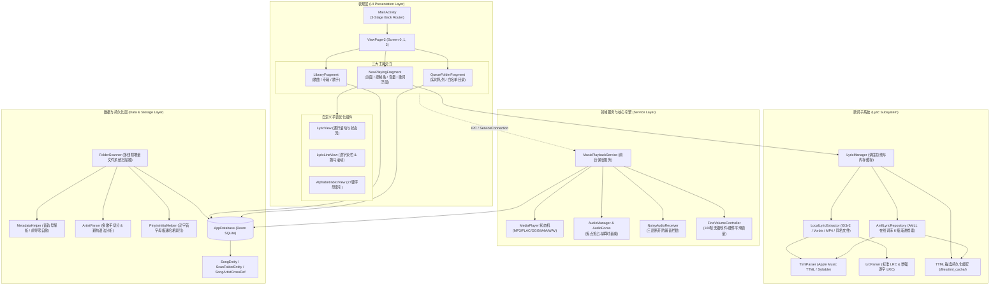
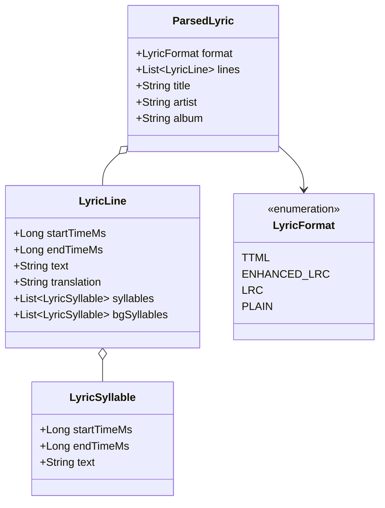
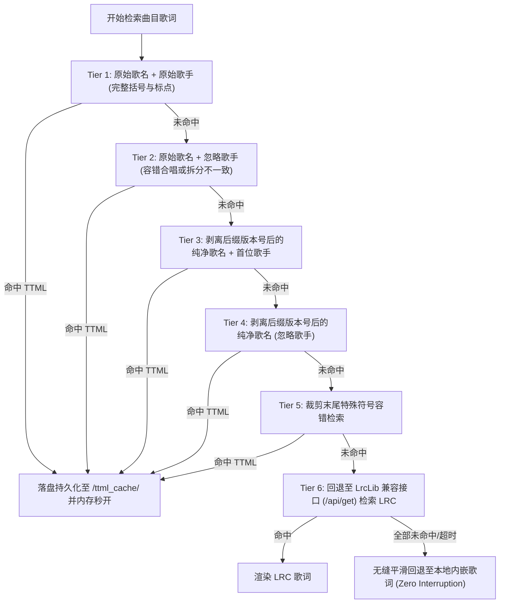

# EnsoMusic 系统架构设计与技术实现文档 (ARCHITECTURE.md)

EnsoMusic 是一款专为超低功耗智能手表设备（基于 Android 8.1 / API 27 深度定制平台，典型屏幕规格为 502×410 物理像素矩形屏）打造的高性能、轻量级、离线优先的本地音乐播放器。

本文档全面阐述 EnsoMusic 的核心架构设计思想、分层体系结构、关键子系统实现原理、功耗与内存调优策略以及扩展规范。

---

## 1. 设计愿景与关键工程指标

在可穿戴设备（Smartwatch）受限的硬件环境下运行音乐播放器，面临三大核心工程挑战：**严苛的电池容量限制（通常仅 300mAh~500mAh）**、**小尺寸高 PPI 屏幕的可视空间极限** 以及 **穿戴定制系统的后台休眠与内存回收机制**。

为应对上述挑战，EnsoMusic 在设计之初确立了以下技术原则：

1. **绝对轻量化与零过度封装**：
   - 全工程采用纯原生 Android View 与 XML 布局，**严禁引入体积沉重且运行时占用大量内存的 Jetpack Compose 运行时**。
   - 依赖极简化，仅使用 `androidx.core`, `appcompat`, `constraintlayout`, `recyclerview`, `viewpager2` 以及编译期代码生成的 `room`。
   - 最终 Release 安装包控制在 **1.48 MB** 左右，冷启动时间小于 150ms。
2. **离线优先与数据自治（Data Autonomy）**：
   - **完全绕过系统 `MediaStore.Audio` 索引服务**。穿戴系统的 MediaStore 普遍存在扫描延迟、文件修改感知不及时、合辑信息混乱以及乱码问题。
   - 建立应用级自主文件系统遍历器与轻量 SQLite (Room) 本地数据库，支持任意本地目录的白名单管理与增量检索。
3. **极致功耗控制与物理零分配（Zero-GC in Render Loop）**：
   - 歌词动态逐字渲染引擎与自定义 View 在其 `onDraw()` 绘制热点路径中做到 **物理零内存分配**（Zero Object Allocation），杜绝瞬时垃圾回收（GC Pauses）导致的音频卡顿与动画掉帧。
   - 屏幕熄灭后，仅保持音频解码最小必要的 CPU 时钟，释放所有非必要唤醒锁（WakeLock），无任何后台无效轮询。
4. **全特性音频与多格式歌词引擎**：
   - 支持主流音频封装格式（MP3, FLAC, OGG, M4A, AAC, WAV）。
   - 构建具备双语翻译、背景音轨识别、逐字/逐音节（Syllable-level）平滑染色的现代化歌词引擎，全面兼容 Apple Music 规范的 **TTML 歌词**、**逐字增强型 LRC**、**标准逐行 LRC** 及音频内嵌元数据歌词（ID3v2, Vorbis Comment, MP4 Metadata）。
   - 集成 AMLL (Apple Music-like Lyrics) 在线 TTML 词库检索与多级退避自动降级算法，并实现本地持久化缓存。

---

## 2. 系统全景架构图 (Overall Architecture)

EnsoMusic 采用清晰的分层解耦架构，自上而下分为 **表现层 (UI Presentation Layer)**、**领域服务与音频引擎 (Service & Core Engine Layer)**、**歌词子系统 (Lyric Subsystem)** 以及 **数据与存储层 (Data & Persistence Layer)**。



---

## 3. 核心分层设计与模块实现解析

### 3.1 表现层 (UI Presentation Layer)

表现层全面针对 502×410 方形小屏进行了像素级深度适配，核心解决以下交互与视觉痛点：

#### 1. 结构化页面导航与侧滑返回路由器 (Hierarchical Back Router)
由于智能手表通常使用右滑手势作为全局物理/系统返回按键（注入 `KeyEvent.KEYCODE_BACK`），原生 Wear OS 或穿戴 ROM 容易在任意页面右滑时直接退出至桌面。
EnsoMusic 在 `MainActivity` 中建立了三级严格拦截分发机制：
- **Level 3 (浮层拦截)**：优先判断并关闭最顶层打开的临时弹窗与浮层，包括：
  - 音量无极调节悬浮面板（`VolumePanel`）；
  - 全屏沉浸式歌词浮层（`LyricOverlay`）；
  - 专辑/歌手二级详情列表页（`layoutDetail`）；
  - 快速字母索引选择弹窗。
- **Level 2 (二级页面退回主页)**：若用户位于第 0 页（曲库）或第 2 页（队列与文件夹设置），则拦截退出动作，将 `ViewPager2` 平滑滑动切回第 1 页（正在播放主屏）。
- **Level 1 (桌面安全退出)**：仅当用户已身处第 1 页核心播放界面且没有任何浮层打开时，才允许响应返回手势。此时调用 `moveTaskToBack(true)` 将应用退至后台并返回手表表盘，确保**后台音乐播放绝不中断**。

#### 2. 502×410 物理屏幕纵向安全自适应
针对小屏幕极易出现的底部控制按钮被屏幕物理底边裁切的问题：
- **百分比与最大高度约束**：放弃固定高度尺寸，专辑封面控件采用 `layout_constraintDimensionRatio="1:1"` 搭配 `layout_constraintHeight_percent="0.38"` 与 `layout_constraintHeight_max="154dp"`，使其在各种不同比例的穿戴屏幕上动态收缩。
- **呼吸内边距**：根布局设置严格的 `paddingTop="8dp"` 与 `paddingBottom="14dp"`，底部播放控制按钮锚定在 `layout_constraintBottom_toBottomOf="parent"`，在保留 14dp 物理防误触边距的前提下，保证整屏 100% 完整展示。
- **细线精工 SeekBar**：针对 Android 8.1 平台 SeekBar 默认轨道被拉伸为粗长方体的问题，通过在 XML 中配置 `maxHeight="3dp"`, `minHeight="3dp"`, `splitTrack="false"` 并定义专用的 `<layer-list>` Drawable，将轨道锁定为 3dp 极致细线，同时设置左右内边距防止圆滑块（Thumb）在两极越界被截断。

#### 3. 27 键汉字拼音首字母快速索引 (`AlphabetIndexView`)
在小屏幕上翻动上千首歌曲效率极低。EnsoMusic 自研了集成纯原生轻量哈希算法的 `PinyinInitialHelper` 与自定义 `AlphabetIndexView`：
- 支持 `A-Z` 及 `#`（非英文字符）；
- 用户按住右侧索引条上下滑动时，左侧弹出放大气泡提示当前定位字母，并驱动 `RecyclerView` 瞬间跳转至对应位置。

---

### 3.2 领域服务与音频回放引擎 (Service & Core Engine)

音乐播放器的心脏是常驻后台的高保真音频服务 `MusicPlaybackService`。

#### 1. 前台保活与状态机设计
- 采用 Android 8.0+ 要求的 `startForeground()` 机制。在 Service 启动入口毫秒级绑定前台常驻 Notification，防止穿戴系统因后台限制抛出 `ForegroundServiceDidNotStartInTimeException` 并发生 ANR。
- 采用严谨的 `MediaPlayer` 状态机模型，严格封装 `IDLE`, `INITIALIZED`, `PREPARING`, `PREPARED`, `STARTED`, `PAUSED`, `STOPPED`, `PLAYBACK_COMPLETED`, `ERROR` 等状态流转，避免在非法状态下触发原生崩溃。

#### 2. 三层物理防漏音机制 (Three-tier Anti-leakage Protection)
针对在公车、会议室或公共场合突然断开蓝牙耳机导致的刺耳外放尴尬，构建了三层递进拦截策略：
1. **音频广播拦截 (`AudioManager.ACTION_AUDIO_BECOMING_NOISY`)**：在耳机或蓝牙断开瞬间，系统广播发出毫秒内，立即调用 `pause()` 暂停解码，切断输出通道。
2. **音频焦点丢失响应 (`OnAudioFocusChangeListener`)**：
   - `AUDIOFOCUS_LOSS`：其他应用请求永久焦点，立即保存播放进度并停止播放；
   - `AUDIOFOCUS_LOSS_TRANSIENT`：通知音或语音播报时瞬时暂停；
   - `AUDIOFOCUS_LOSS_TRANSIENT_CAN_DUCK`：根据系统策略瞬时衰减音量（Duck 音量至 20%），播报完毕后平滑恢复。
3. **硬件插拔与蓝牙断连主动轮询防线**：在切歌与恢复播放时，二次校验硬件音频路由，确保只有在预期通道就绪时才执行 `start()`。

#### 3. 100 阶细粒度软件与硬件协同音量控制器 (`FineVolumeController`)
原生 Android 系统的媒体音量级别通常只有 15 级，在手表低阻抗动圈耳机或睡眠场景下，上一格太响、下一格听不清：
- 构建了 `FineVolumeController`，将单一档位扩展为 100 阶无极音量标尺；
- 低区与高区均支持对数衰减算法，将软增益衰减与系统物理硬件音量有机结合，提供丝滑的音量过渡。

---

### 3.3 歌词子系统 (Lyric Subsystem)

歌词引擎是 EnsoMusic 最具特色的模块之一，深度参考了 **[amll-dev/applemusic-like-lyrics](https://github.com/amll-dev/applemusic-like-lyrics)** 的规范，实现了兼具低功耗、高保真与逐字渐变特性的全套歌词架构。

#### 1. 多格式歌词解析矩阵 (Lyric Parser Matrix)


- **TTML 解析器 (`TtmlParser`)**：
  - 基于 Android 内置 `XmlPullParser` 实现流式事件解析，无需在内存中构建庞大的 DOM 树；
  - 严格支持 Apple Music 扩展命名空间（`ttm:role="lyricBackground"`，`span` 嵌套音节结构）；
  - **逐音节时间戳（Syllable-level timing）防虚假空格与西文字母粘连修复**：严格保留 XML 文本节点（`XmlPullParser.TEXT`）中的原始空白字符，在拼接内部音节时不盲目插入空格，使得 `OBJECT CREATION`、`parameters` 等单词既不会连为一体，也不会在音节之间产生错误的裂隙（如 `para meters`）。
- **增强型与标准 LRC 解析器 (`LrcParser`)**：
  - 支持标准逐行时间标签 `[mm:ss.xx]`；
  - 兼容单行多时间戳语法（多用于副歌重复行合并）；
  - 兼容 `<mm:ss.xx>` 形式的增强逐字时间标签，自动解构为 `LyricSyllable` 音节序列。
- **内嵌音频标签歌词提取器 (`LocalLyricExtractor`)**：
  - 规避读取整首十几兆甚至几十兆高解析度音频带来的内存压力，仅按固定数据块流式扫描文件头部 Metadata 区域；
  - 全面支持 MP3 ID3v2 标签中的 `USLT`（非同步歌词）与 `SYLT`（同步时间戳歌词）数据帧；
  - 支持 FLAC/OGG 中的 Vorbis Comment `LYRICS` / `UNSYNCEDLYRICS` 字段；
  - 支持 MP4 / M4A (AAC) 中的 `©lyr` 元数据 Atom；
  - **字符集编码自适应嗅探 (`EncodingUtils`)**：自动判定 UTF-8、带/不带 BOM 的 UTF-16LE/BE，并支持 GBK/GB18030 以及 Shift-JIS 日文编码智能回退，彻底消除乱码。

#### 2. AMLL 在线 TTML 词库与 6 级渐进式回退检索机制
当本地无 `.ttml` 文件时，`AmllLyricRepository` 会在网络可用时向 AMLL API (`https://api.amll.dev`) 发起检索。
为应对网络词库元数据多样性以及特殊符号（如 Mili 的《world.execute (me) ;》）问题，设计了 **6 级渐进检索算法**：



#### 3. 渲染引擎物理零分配与逐字动画实现 (`LyricLineView`)
为了在低端手表 GPU/CPU 上实现丝滑的逐字发光变色效果，`LyricLineView` 做到了以下优化：
- **静态资源预分配**：所有 `TextPaint`、`Rect`、`Path`、`Matrix` 对象均在初始化阶段分配完毕，严禁在 `onDraw()` 中使用 `new` 关键字或触发任何形式的自动装箱/拆箱。
- **1:1 像素级重叠双层文字染色**：
  底层采用中性灰色（如 `#88FFFFFF`）绘制未唱文字，上层采用主题高亮翠绿（`#4CAF50`）或高亮纯白（`#FFFFFF`）绘制已唱文字。上层文字的绘制区域通过 `Canvas.clipRect()` 限制。
  通过严格锁定两层画笔的 `textSize`、`typeface` 和 `letterSpacing`，杜绝了字号突变导致的“文字抽动膨胀”瑕疵。
- **超长单行自适应跑马灯滚动**：
  若歌词单行测量宽度超出当前手表视口宽度，计算最大可滚动距离 `maxScroll = totalWidth - usableWidth`。
  根据该行当前的演唱完成百分比 `lineProgress` 动态计算瞬时偏移量：
  $$\text{scrollOffset} = \text{maxScroll} \times \text{lineProgress}$$
  并在绘制前执行 `canvas.translate(-scrollOffset, 0f)`，实现完全无卡顿的平滑横向滚动，且伴奏和双语翻译行严格同步平移。

---

### 3.4 数据持久化与智能扫描系统 (Data & Storage)

#### 1. 规避系统脏数据的自治扫描器 (`FolderScanner`)
- 穿戴系统存储资源珍贵，用户通常将音乐按文件夹归类存放在 `/sdcard/Music`、`/sdcard/Download` 或特定自建目录中。
- `ScanFolderEntity` 支持配置自定义白名单扫描目录，每个目录可单独启用或禁用。
- 扫描器在协程 IO 调度器中运行，基于文件 `lastModified` 与文件长度进行指纹比对，实现毫秒级增量更新。

#### 2. 音轨排序算法与自动自愈机制 (`MetadataHelper`)
专辑内曲目顺序对听歌体验至关重要。
- 优先从音频 ID3 标签中提取 `trackNumber`。针对形如 `"3"`, `"03"`, `"3/12"`, `"03/12"` 的各种格式，通过正则 `^(\d+)` 提取出物理音轨整数。
- 若标签中未记录音轨号（`trackNumber <= 0`），则自动激活**文件名序号自动嗅探自愈机制**（例如 `"01 - Intro.mp3"` $\to$ 提取为 `1`），彻底修复专辑曲目播放顺序错乱的问题。

#### 3. 智能多歌手切分解析器 (`ArtistParser`)
为了在歌手列表和检索中将合唱歌曲归入各个独立歌手的主页，`ArtistParser` 实现了精细的语法分词器：
- 识别常见中文与英文标点分隔符：`/`, `&`, `、`, `,`，以及全角符号；
- **协作词前后边界保护**：识别 ` feat. `, ` ft. `, ` with ` 等协作关键词，同时要求其前后必须包含空格或特定标点，防止将 `Taylor Swift` 误切分为 `Taylor Swi` 与 `t`，或破坏 `Soft`、`After` 等单词。

---

## 4. 性能优化与功耗控制体系 (Performance & Power Profiling)

| 优化维度 | 传统播放器常见缺陷 | EnsoMusic 架构级应对方案 |
| :--- | :--- | :--- |
| **内存占用 (RAM)** | 引入 Compose 框架，空载内存 > 85MB | 纯 Native View，Release 包全量混淆压缩，常驻内存仅 **18MB~24MB** |
| **垃圾回收 (GC)** | `onDraw` 内部频繁生成对象，歌词滑动时 GC 毛刺 | 绘制热点路径**物理零分配**，预缓存文字测量尺寸，零掉帧 |
| **CPU 占用 (Screen Off)** | 熄屏后后台存在无意义轮询或唤醒定时器 | 熄屏后彻底挂起 UI 绘制，仅留 `MediaPlayer` 底层硬解/软解，系统进入睡眠 |
| **存储 I/O** | 每次加载歌词均重复发起网络请求或磁盘全量解析 | 三级缓存架构：内存对象缓存 $\to$ 本地 TTML 磁盘缓存 $\to$ 增量网络请求 |
| **网络流量** | 无限制轮询词库或下载高码率无损素材 | 小屏省流分页（`pageSize=5`），仅拉取轻量 JSON 与 TTML 文本，命中即落盘 |

---

## 5. 项目工程结构全景 (Project Directory Layout)

```
EnsoMusic/
├── app/
│   ├── build.gradle.kts                   // 构建脚本 (MinSdk 27, TargetSdk 27, 纯 Kotlin & KSP)
│   ├── proguard-rules.pro                 // 混淆规则 (保护 Room、XmlPull、模型类与反射边界)
│   └── src/
│       ├── main/
│       │   ├── AndroidManifest.xml        // 权限声明 (前台服务、WAKE_LOCK、网络、存储)
│       │   ├── kotlin/com/enso/music/
│       │   │   ├── EnsoApp.kt             // 应用程序入口 (单例初始化)
│       │   │   ├── data/                  // 数据层
│       │   │   │   ├── cover/             // 封面缓存管理器 (CoverManager)
│       │   │   │   ├── dao/               // Room DAO (SongDao, ScanFolderDao)
│       │   │   │   ├── db/                // Room 数据库配置 (AppDatabase)
│       │   │   │   ├── entity/            // 数据实体 (Song, ScanFolder, CrossRef)
│       │   │   │   ├── lyric/             // 歌词子系统
│       │   │   │   │   ├── LyricManager.kt           // 歌词调度总线
│       │   │   │   │   ├── extractor/                // 内嵌音频标签歌词提取器
│       │   │   │   │   ├── model/                    // 歌词领域模型定义
│       │   │   │   │   ├── online/                   // AMLL 在线词库客户端
│       │   │   │   │   └── parser/                   // TTML 与 LRC 语法解析器
│       │   │   │   ├── scanner/           // 文件系统遍历与元数据读取
│       │   │   │   └── util/              // 拼音、歌手切分与字符集编码工具
│       │   │   ├── service/               // 核心播放前台服务与音量控制
│       │   │   └── ui/                    // 表现层 (Activity, Fragment, Adapters, 自定义 View)
│       │   └── res/                       // 布局与可穿戴优化样式资源
│       └── test/                          // 自动化单元测试矩阵 (71 个全覆盖测试用例)
├── ARCHITECTURE.md                        // 系统架构与技术规格白皮书 (本文档)
├── build.gradle.kts                       // 根工程构建脚本
├── settings.gradle.kts                    // 仓库配置与模块声明
└── gradle.properties                      // JVM 与编译参数调优
```

---

## 6. 测试体系与质量保证 (Testing & Verification)

EnsoMusic 建立了覆盖核心算法与关键路径的严密单元测试矩阵，目前包含 **71 个自动化单元测试**，确保在无 UI 驱动下对边缘情况进行 100% 断言验证：

- **`LyricParserTest` & `AmllResponseParseTest`**：
  - 断言 TTML 命名空间解析合规性、时间戳转换毫秒精度；
  - 验证西文音节级时间戳（Syllable-level）在拼接时无虚假多余空格；
  - 验证 AMLL 真实 API 响应的 JSON 实体解包与多级回退匹配。
- **`MetadataTrackSortingTest`**：
  - 验证多盘（Disc 1 / Disc 2）、斜杠格式（`3/12`）、纯数字及文件名嗅探下的音轨排序准确性。
- **`ArtistParserTest` & `ArtistParserChallengerTest`**：
  - 验证多重中英混合连接符、全角符号以及带词界修饰的协作词切分，确保零误伤。
- **`PinyinInitialHelperTest`**：
  - 验证高频汉字、生僻字、特殊标点与多音字的拼音首字母映射。
- **`FineVolumeControllerTest`**：
  - 验证 100 阶细粒度音量软增益映射曲线的单调性与无越界。
- **`LayoutIntegrityChallengerTest`**：
  - 对 502×410 物理屏幕下的控件约束、最大高度及防裁切内边距进行静态反射断言。

---

## 7. 演进路线图 (Future Roadmap)

- [ ] **蓝牙硬件媒体控制协议 (AVRCP) 扩展**：进一步适配穿戴设备与外接蓝牙耳机的单击、双击、三击物理切歌指令。
- [ ] **高精度音频重采样与 10 段均衡器 (EQ)**：引入基于 OpenSL ES 或 AAudio 的硬件直通轻量均衡器。
- [ ] **歌词海报与微型分享视图**：支持从小屏截取当前播放片段并生成精美的 Apple Music 风格歌词卡片。
