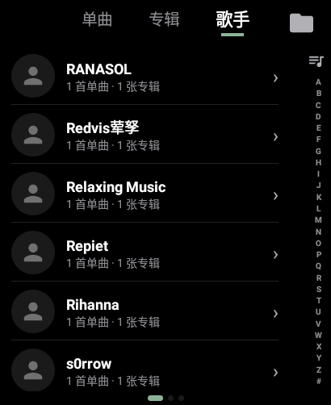
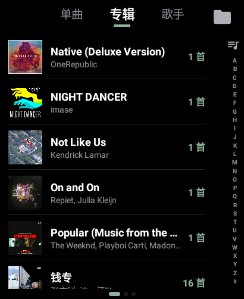
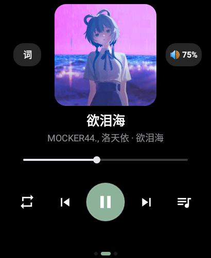
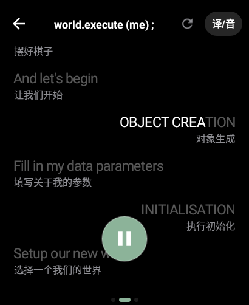
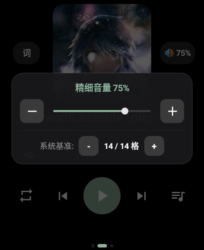
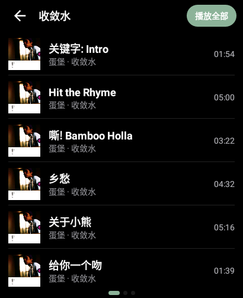
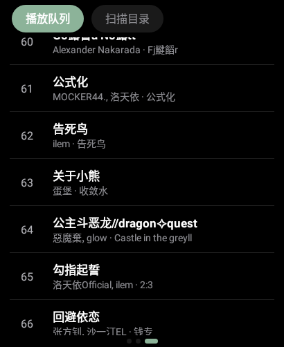
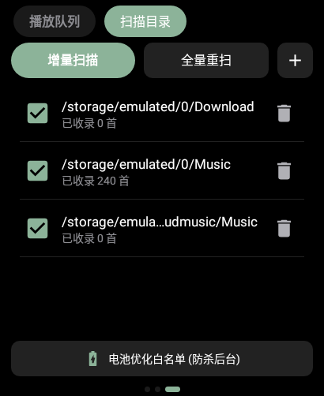

<div align="center">
  
  <h1>EnsoMusic</h1>
  <p><strong>专为方形小屏 Android 智能手表打造的轻量本地音乐播放器</strong></p>

  <p>
    
    
    
    <a href="https://github.com/wjhhm2003/EnsoMusic/releases">
      
    </a>
  </p>
</div>

> [!IMPORTANT]
> 本项目完全由 **AI 辅助与驱动开发**，作者主要负责需求规划、真机测试与体验打磨。如果代码中存在不够优雅的地方，欢迎大家提交 Issue 或 PR 一起改进！

---

## 💡 它能做什么？

专门为市面上的全功能方形小屏 Android 智能手表（华强北手表）所打造

**EnsoMusic** 专为手表的硬件环境定制，**安装包仅约 1.5 MB，运行时内存占用稳定在 20 MB 左右**，在手腕上提供省电、纯粹、完整的本地听歌体验：

### 1. 小屏直觉交互
- **三屏架构**：全应用仅保留**左屏曲库**、**中屏播放**、**右屏队列与目录管理**，左右滑动即可完成高频操作。
- **防误触热区扩展**：控制按钮均向外扩展了实际点击热区，盲操更从容。
- **省电配色**：全局采用纯黑背景，降低屏幕发光功耗与夜间视觉疲劳。

### 2. 精细音量、无缝播放与断连停播
- **专辑无缝播放（Gapless Playback）**：播放引擎支持下一首曲目预加载与缓冲衔接，在切歌过渡时消除解码空隙与静音卡顿。配合专辑音轨顺序修正功能，在聆听古典乐交响曲或概念专辑时，能够还原连贯的音乐体验。
- **100 级音量**：早期 Android 系统原生媒体音量仅有 15 级，EnsoMusic 结合系统硬件音量与软件增益衰减算法，将音量细分为 **1～100 级**，夜间听歌更舒适。
- **防外放保护**：针对蓝牙耳机断连、有线耳机拔出以及系统语音播报抢占音频焦点等场景做了三层监听。一旦检测到耳机断开，播放器会切断音频输出并暂停播放，防止手表扬声器~~在教室~~突然外放。

### 3. 🗂️ 独立曲库引擎与智能检索
绕过手表端残缺的系统 `MediaStore`，支持手动指定自定义扫描目录（如 `/sdcard/Music`）：
- **多歌手拆分**：自动识别包含 `/`、`&`、`、` 或 `feat.` 的合唱曲目，并将其分别归入每位参与歌手名下。进入任意歌手详情页，均可查看其独唱与合作的全部单曲。
- **拼音首字母双索引**：列表右侧配备 `A–Z` 与 `#` 索引条，既支持**按住上下滑动**快速定位，也支持**点按展开大号字母网格**。
- **专辑曲目顺序修正**：优先解析音频内嵌音轨号（兼容 `3/12` 等格式）；对于未写入音轨标签的文件，会自动提取文件名开头的数字序号（如 `01 - Intro.mp3`）。

### 4. 🎵 高性能逐字歌词引擎
- **全格式解析**：原生支持 **TTML**、**增强型逐字 LRC**、**标准 LRC** 以及内嵌于 `MP3` / `FLAC` / `OGG` / `M4A` 标签中的歌词；支持双语翻译、背景人声与逐字染色高亮，超长歌词句可根据演唱进度平滑横向滚动。
- **在线匹配与离线缓存**：当本地缺失歌词时，联网状态下会依次通过 **AMLL TTML Database** 与 **LRCLIB** 自动检索匹配，下载后直接持久化缓存至本地，后续离线亦可随时查看。
- **多编码自动探测**：内置 `UTF-8`、`UTF-16`、`GBK / GB18030` 与 `Shift-JIS` 字符集自动识别，告别早期老歌标签与歌词乱码。
- **零内存分配渲染**：针对手表的 CPU 与电池，歌词视图在渲染循环中实现了零对象分配，长时间开启逐字歌词也不会引发 GC 卡顿或机身发热。

---

## 📸 界面预览

| 歌曲列表 | 歌手视图 | 专辑视图 |
| :---: | :---: | :---: |
|  |  |  |
| **播放主界面** | **逐字歌词** | **100 级音量** |
|  |  |  |
| **专辑详情** | **播放队列** | **目录扫描** |
|  |  |  |

---

## 🚀 快速上手与构建

### 安装与使用
1. 前往 [Releases](https://github.com/wjhhm2003/EnsoMusic/releases) 页面下载最新 `.apk` 并安装至手表（需 **Android 8.1 / API 27** 及以上）。
2. 启动应用后向右滑动至**最右侧页面**，点击左上角的 **“扫描目录”**，添加手表内存储音乐的文件夹并执行扫描。
3. 享受你的音乐。

### 本地编译构建
克隆本仓库后，在项目根目录下执行以下命令即可构建 Debug 安装包：

```shell
git clone https://github.com/wjhhm2003/EnsoMusic.git
cd EnsoMusic
./gradlew assembleDebug
```

编译完成后，生成的 APK 位于 `app/build/outputs/apk/debug/` 目录下。

---

## 📂 项目结构与架构

```text
EnsoMusic/
├── app/                 # Android 主工程源码（UI、音频服务、歌词引擎、Room 数据库等）
├── art/                 # 应用 Logo 与界面预览截图
├── benchmark-results/   # 性能与基准测试结果数据
├── tools/               # 开发与构建辅助工具脚本
├── ARCHITECTURE.md      # 详细模块划分、数据库结构与零分配渲染架构文档
└── build.gradle.kts     # Gradle 构建脚本
```

关于具体的模块划分、数据库表结构设计以及歌词引擎的渲染实现细节，请参阅 [ARCHITECTURE.md](ARCHITECTURE.md)。

---

## 🙏 鸣谢

- **[Apple Music-like Lyrics (AMLL)](https://github.com/amll-dev/applemusic-like-lyrics) & [AMLL TTML Database](https://github.com/Steve-xmh/amll-ttml-db)**  
  感谢 `@Steve-xmh` 及所有词库贡献者提供的高质量逐字歌词。
- **[LRCLIB](https://lrclib.net/)**  
  感谢提供开放、免鉴权的同步歌词检索服务。
- **[Android Open Source Project (AOSP)](https://source.android.com/) & AndroidX**  
  项目基于原生 Android View 体系与 Room、ViewPager2 构建，以最小开销适应穿戴设备的内存与功耗限制。

---

<div align="center">
  如果这个小工具提升了你的手表听歌体验，欢迎点亮一颗 ⭐ <strong>Star</strong> 或提交 <strong>Issue</strong> 交流！
</div>
